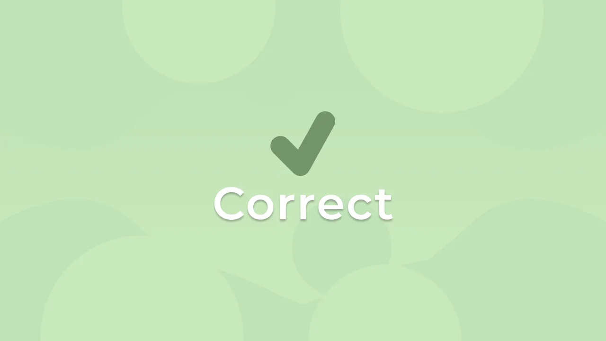
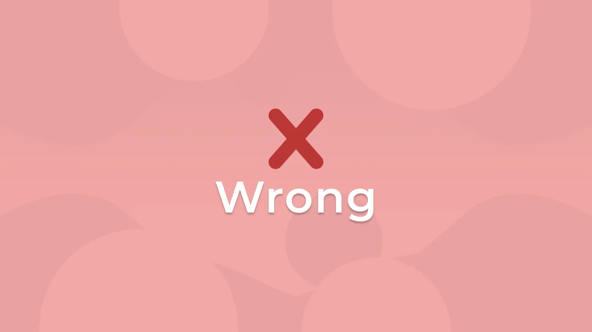
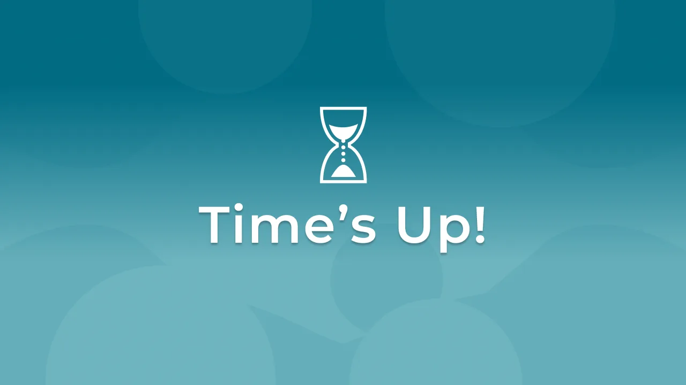
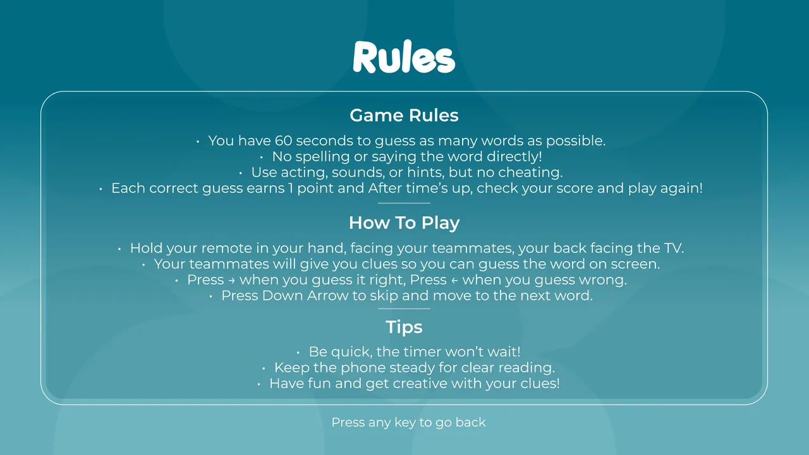
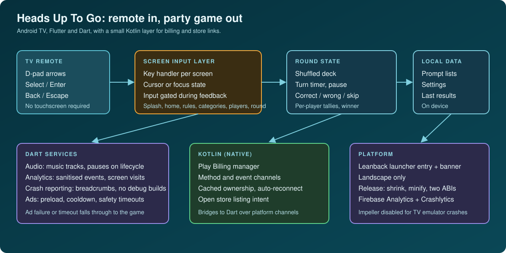
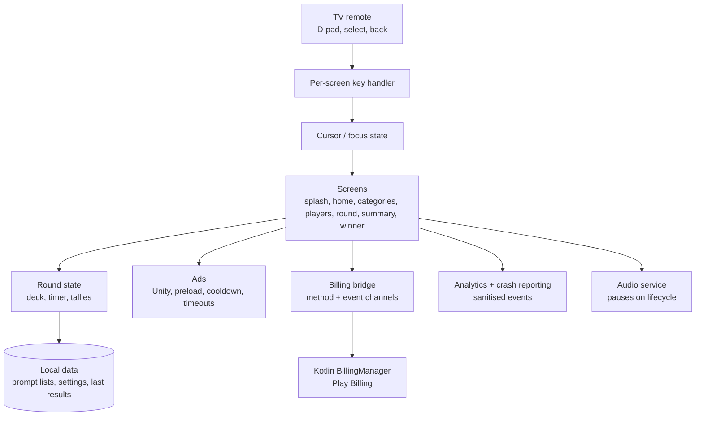

# Heads Up To Go

**A remote-controlled party game for Android TV: players take turns acting out and describing prompts while the TV shows the word, the timer and the score, and every action is a D-pad press.**

**Android TV** 
Flutter · Dart · Kotlin · Firebase · Play Billing · Unity Ads · D-pad input architecture

<table>
  <tr>
    <td align="center"> Correct</td>
    <td align="center"> Wrong</td>
  </tr>
  <tr>
    <td align="center"> Pass</td>
    <td align="center"> Time's up</td>
  </tr>
</table>
<b>Product artwork</b>: the four result-state backgrounds shown between prompts (design assets, not screenshots).

---

## Get the App

  

The Play listing is titled "Heads Up To Go: Charades TV". The app declares the Leanback launcher category and does not require a touchscreen.

<!-- fw-sale:start -->
## Reach & Availability

| | |
|---|---|
| **Product sale** | This is a Future Watch product and it is **available to buy or license** for your own business. [Ask about buying Heads Up To Go](https://futurewatch.co/contact?type=product&ref=heads-up-to-go) or email [rehan@futurewatch.co](mailto:rehan@futurewatch.co). |
<!-- fw-sale:end -->

## Product at a Glance

| | |
|---|---|
| **What it is** | A party game for a living-room TV: one player acts or describes, the others guess, and the remote marks the result |
| **Platform** | Android TV only (Leanback launcher entry, TV banner, no touchscreen requirement, landscape) |
| **Input** | Remote D-pad, select and back. No touch path |
| **Players** | 2 to 6 selectable, with optional custom names entered on an on-screen keyboard |
| **Round** | One timed turn per player; the timer length is a setting from 60 to 180 seconds in 20-second steps |
| **Content** | 5 featured cards, 9 free categories, 18 paid categories and 5 bundles in the catalogue; about 7,000 bundled prompts across 25 word lists (approximate, counted by line) |
| **Monetisation** | Unity Ads (interstitial and rewarded), a no-ads subscription, one-time category purchases through a native Play Billing manager |
| **Telemetry** | Firebase Analytics and Crashlytics behind a sanitising layer |
| **Code size** | About 21k lines of Dart (52 files, of which about 8k are prompt lists) and about 570 lines of hand-written Kotlin |
| **Tests** | 23 unit tests in 3 files (analytics sanitiser, ad placement, category labels) |

## Product Artwork (Android TV)

**No real Android TV screenshots are included in this repository.** Every image below is production artwork or a design asset. None of them is a screenshot, and none shows the app running on a device.

<table>
  <tr>
    <td align="center"> <b>App icon</b> Product artwork (not a screenshot)</td>
    <td align="center"> <b>Rules screen background</b> Design asset with the rules text baked in (not a screenshot)</td>
  </tr>
</table>

<table>
  <tr>
    <td align="center"> <b>Correct</b> Result-state artwork</td>
    <td align="center"> <b>Wrong</b> Result-state artwork</td>
    <td align="center"> <b>Pass</b> Result-state artwork</td>
    <td align="center"> <b>Time's up</b> Result-state artwork</td>
  </tr>
</table>

Other production artwork (the launcher banner, category cards and illustrated backgrounds) is deliberately not republished here. See [docs/PRIVACY_AND_SOURCE.md](docs/PRIVACY_AND_SOURCE.md).

## One Game. One Remote.

  

## Key Features

- **Remote-only play.** During a round, Right marks correct, Left marks wrong, Down passes, Up opens a pause menu, and Select pauses or resumes.
- **Turn-based scoring.** Each player gets a timed turn over a shuffled deck; correct answers score a point, a per-turn summary lists correct, wrong and passed words, and the highest score wins.
- **Category catalogue.** Free categories, paid categories, bundles that combine several word lists, and a carousel interface that expands the focused card.
- **Custom player names.** A QWERTY grid on screen, navigated with the D-pad, so names can be typed with a remote.
- **Ways to unlock.** One-time purchase, a no-ads subscription, a rewarded ad for a single play, and a games-played counter on some categories.
- **Audio.** Selectable background music tracks that pause when the app leaves the foreground and resume on return.
- **Last-game leaderboard.** The final standings are stored locally and shown ranked.

## Engineering Highlights

### Driving a game with four arrow keys
- **Problem:** a TV remote cannot tap. Every screen needs a position model the user can predict, and a game round needs the same four keys to mean something different from menu navigation.
- **Approach:** each screen owns a single key handler and a small cursor or section/index state that it moves explicitly (for example `section` and `index` on the category catalogue, or a row and column on the name keyboard). Round input is a separate mapping: arrows score, Select pauses, and a boolean disables scoring while a feedback screen is showing.
- **Outcome:** movement between rows, carousels and keyboard keys is deterministic and written down in code, rather than left to geometric focus search.

### Focus that survives route changes and dialogs
- **Problem:** after pushing or popping a route, or closing a dialog, Flutter may leave no widget holding focus, and a TV user then has a dead remote.
- **Approach:** the round screen releases its focus node before navigating away, sets a flag so it does not re-acquire focus afterwards, and requests focus again after a short delay when the route is current. The pause dialog owns its own focus scope and key listener and handles Back and Escape as resume.
- **Outcome:** the code re-establishes remote focus after the summary screen and the pause dialog instead of relying on the framework to pick a widget.

### Not letting an ad or a billing call block the game
- **Problem:** an interstitial that never calls back would leave a living-room TV stuck on a loading state.
- **Approach:** ads initialise in the background, preload with timeouts, enforce a cooldown between interstitials, and every show path has a safety timeout that continues into the game. Ad init is skipped when the no-ads entitlement is active, and a full-screen ad flag stops the ad's own pause from being logged as the player leaving the app.
- **Outcome:** an ad failure, skip or timeout all fall through to starting the turn.

### Native billing behind two platform channels
- **Problem:** Play Billing is an asynchronous, callback-based client with reconnects, pending purchases and acknowledgement.
- **Approach:** a Kotlin manager owns the billing client, retries a dropped connection, queries products and purchases, acknowledges unacknowledged purchases and caches ownership locally. Dart talks to it through one method channel and one event channel.
- **Outcome:** the Dart side consumes plain events (products, ownership, purchase success, error, cancel) and can show ownership before a network round trip finishes.

### Keeping analytics valid and bounded
- **Problem:** GA4 silently drops events that break its naming and size rules, and lifecycle callbacks arrive in bursts.
- **Approach:** one sanitiser renames reserved or prefixed events, truncates names and values, caps parameters per event and drops empty values; lifecycle "leave" events are debounced; screen events are logged explicitly instead of through the automatic route observer. The sanitiser has unit tests.
- **Outcome:** event collection that does not depend on every call site getting the rules right.

More: [docs/ENGINEERING_CHALLENGES.md](docs/ENGINEERING_CHALLENGES.md).

## Architecture

Details: [docs/ARCHITECTURE.md](docs/ARCHITECTURE.md).

## Technology Stack

| Layer | Technology |
|---|---|
| App | Flutter, Dart 3 |
| Native | Kotlin: `FlutterActivity` host, Play Billing client (v9), two platform channels plus a store-link intent channel |
| Persistence | `shared_preferences` on the Dart side; `SharedPreferences` for cached billing ownership on the Kotlin side |
| Ads | `unity_ads_plugin` (interstitial and rewarded) |
| Audio | `just_audio` |
| Firebase | Core, Analytics, Crashlytics |
| Build | Release minification and resource shrinking on, two ABIs (arm64-v8a, armeabi-v7a), Java 17 |
| Fonts | Bundled locally, not fetched at runtime |
| Tests | 23 unit tests |

## Documentation

| Read | For |
|---|---|
| [Technical case study](docs/TECHNICAL_CASE_STUDY.md) | End-to-end write-up with the TV input model first |
| [Architecture](docs/ARCHITECTURE.md) | Layers, flows and diagrams |
| [Engineering challenges](docs/ENGINEERING_CHALLENGES.md) | Problem, context, approach, trade-offs, outcome |
| [Product overview](docs/PRODUCT_OVERVIEW.md) | Gameplay, content and screens |
| [Privacy and source](docs/PRIVACY_AND_SOURCE.md) | What is and is not published, and why there are no screenshots |

## Source Code

This repository is a portfolio showcase for a production application. Production source code is maintained privately. See [RIGHTS.md](RIGHTS.md) for usage terms.
