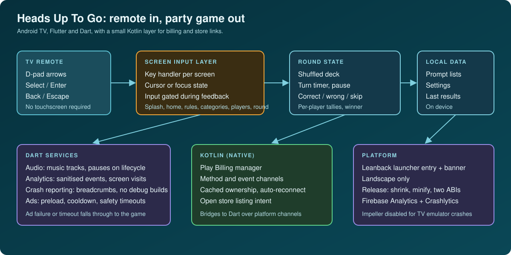
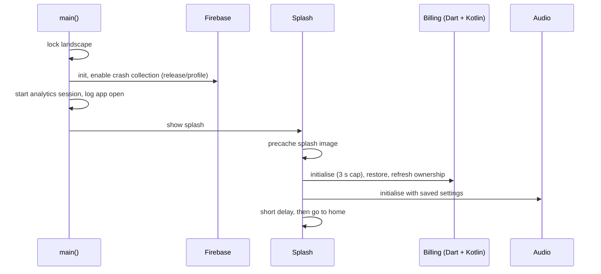
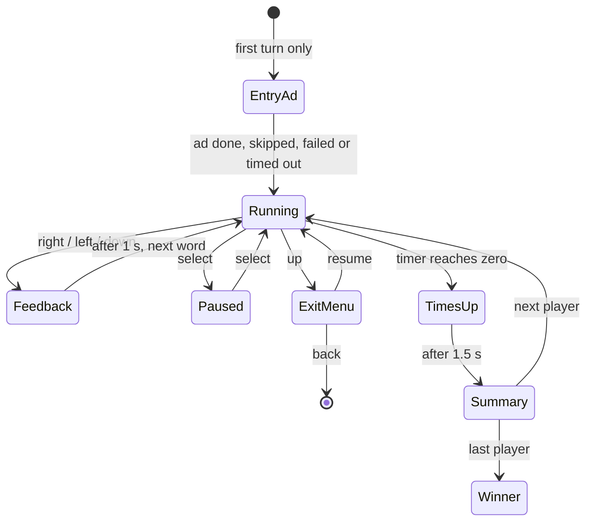
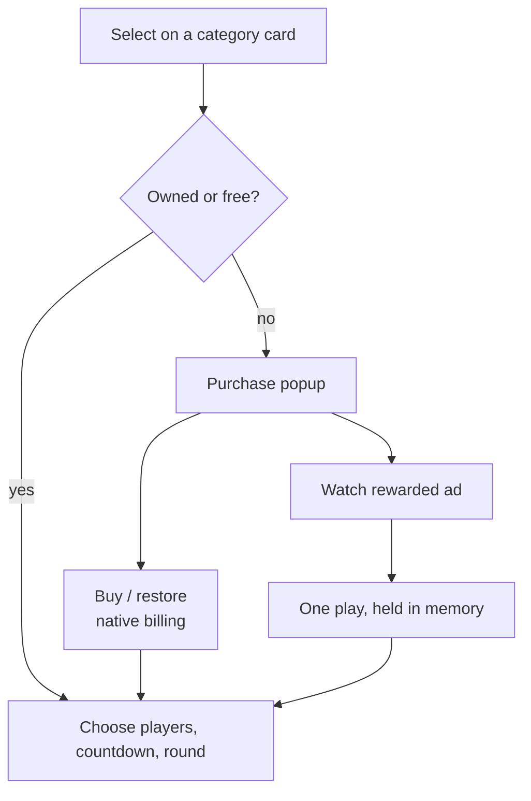
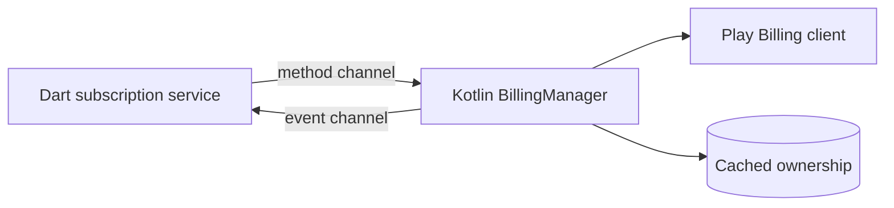

# Architecture

Conceptual view of the Android TV app. Names are descriptive, not production identifiers.

## Layers

| Layer | Responsibility |
|---|---|
| Input | Per-screen key handlers translate D-pad, select and back into cursor moves or round actions |
| Screens | Splash, home, rules, settings, categories, player count, custom names, countdown, round, turn summary, winner, leaderboard |
| Round state | Shuffled deck, current player and word, per-player tallies, turn timer and pause |
| Data | Bundled prompt lists, settings, last game results, games-played counter |
| Services | Audio, analytics, crash reporting, ads, billing client in Dart |
| Native | Kotlin billing manager, store-link intent, activity host |

## Startup

## A turn

## Category selection and unlock

## Billing bridge

Events carried to Dart include billing ready or disconnected, product list, ownership sync, purchase success, error and cancel.

## Focus and cursor ownership

- A screen with an explicit model (categories, player count, names, round) takes focus on a single node that receives all key events and updates its own cursor state.
- A screen with its own dialog hands focus to the dialog's scope and takes it back on close.
- The reusable carousel card widget handles focus visuals only: it animates scale, swaps layout and scrolls itself into view, and swallows horizontal arrows so framework traversal does not fight the cursor model.

## Build and release

Release builds enable minification and resource shrinking, keep Flutter and audio plugin classes through ProGuard rules, and package two ABIs. Signing material is supplied from outside the repository and falls back to debug signing when absent. Details of keys and identifiers are not published.
